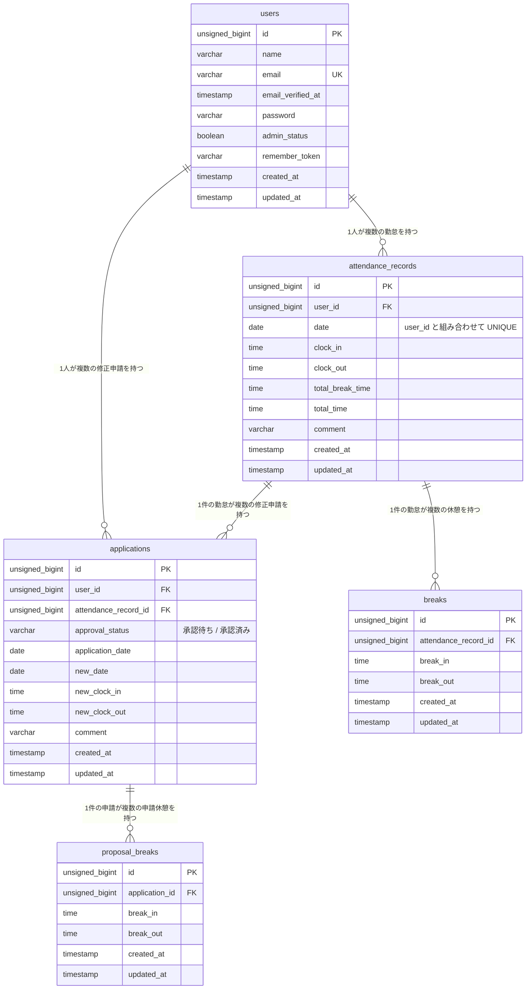

# 勤怠管理アプリ（attendance-app）

一般ユーザーが出勤・休憩・退勤を打刻し、勤怠の修正を申請できる勤怠管理アプリです。
管理者はスタッフ全員の勤怠を日別・スタッフ別に確認し、勤怠の直接修正や修正申請の承認ができます。

## 主な機能

- 一般ユーザー：会員登録／ログイン／打刻（出勤・休憩入・休憩戻・退勤）／月別勤怠一覧／勤怠詳細と修正申請／申請一覧
- 管理者：ログイン／日次勤怠一覧／勤怠詳細と直接修正／スタッフ一覧／スタッフ別月次勤怠一覧／修正申請の一覧と承認

## 使用技術

| 項目 | バージョン |
|---|---|
| PHP | 8.2 |
| Laravel | 10.x |
| MySQL | 8.4 |
| Laravel Fortify | 1.x（認証） |
| Laravel Sail | Docker 開発環境 |
| Mailpit | メール確認 |
| phpMyAdmin | DB 確認 |
| Vite | フロントエンドのビルド（手書き CSS） |

## 環境構築

Docker（Docker Desktop など）が使える環境で、以下を順に実行してください。

```bash
# 1. リポジトリをクローン
git clone https://github.com/yuki-btw/attendance-app.git
cd attendance-app

# 2. Composer パッケージをインストール（Docker で実行）
docker run --rm \
  -u "$(id -u):$(id -g)" \
  -v "$(pwd):/var/www/html" -w /var/www/html \
  -e COMPOSER_CACHE_DIR=/tmp/composer_cache \
  laravelsail/php82-composer:latest \
  composer install

# 3. 環境変数ファイルを作成
cp .env.example .env

# 4. コンテナを起動
./vendor/bin/sail up -d

# 5. アプリケーションキーを生成
./vendor/bin/sail artisan key:generate

# 6. マイグレーションと初期データの投入
./vendor/bin/sail artisan migrate --seed

# 7. フロントエンド
./vendor/bin/sail npm install
./vendor/bin/sail npm run dev
```

- Apple Silicon（M1〜M4 など）の場合は、compose.yaml の mysql に `platform: 'linux/amd64'` を追記してください。
- エイリアスを設定すると `sail` だけで実行できます：`alias sail='[ -f sail ] && bash sail || bash vendor/bin/sail'`
- `.env` の DB・メール設定は `.env.example` の値（`DB_HOST=mysql` / `DB_DATABASE=laravel` / `DB_USERNAME=sail` / `DB_PASSWORD=password`、`MAIL_HOST=mailpit` / `MAIL_PORT=1025`）のままで動きます。

### テストの実行

```bash
./vendor/bin/sail artisan test
```

テストは MySQL の `testing` データベースを使います（Sail の MySQL コンテナ初回起動時に自動で作成されます）。

## ログイン情報（シーダーで作成）

| 種別 | メールアドレス | パスワード | ログイン画面 |
|---|---|---|---|
| 一般ユーザー | user1@example.com | password | http://localhost/login |
| 一般ユーザー | user2@example.com | password | http://localhost/login |
| 管理者 | user3@example.com | password | http://localhost/admin/login |

- 一般ユーザーは `/login`、管理者は `/admin/login` からのみログインできます。
- user1 には過去 6 か月分の勤怠データ（休憩付き）、user2・user3 には直近 3 か月分の勤怠データが入っています。

## URL

| 用途 | URL |
|---|---|
| アプリ（一般ユーザー） | http://localhost/ |
| アプリ（管理者ログイン） | http://localhost/admin/login |
| phpMyAdmin | http://localhost:8080 |
| Mailpit | http://localhost:8025 |

## ER 図


